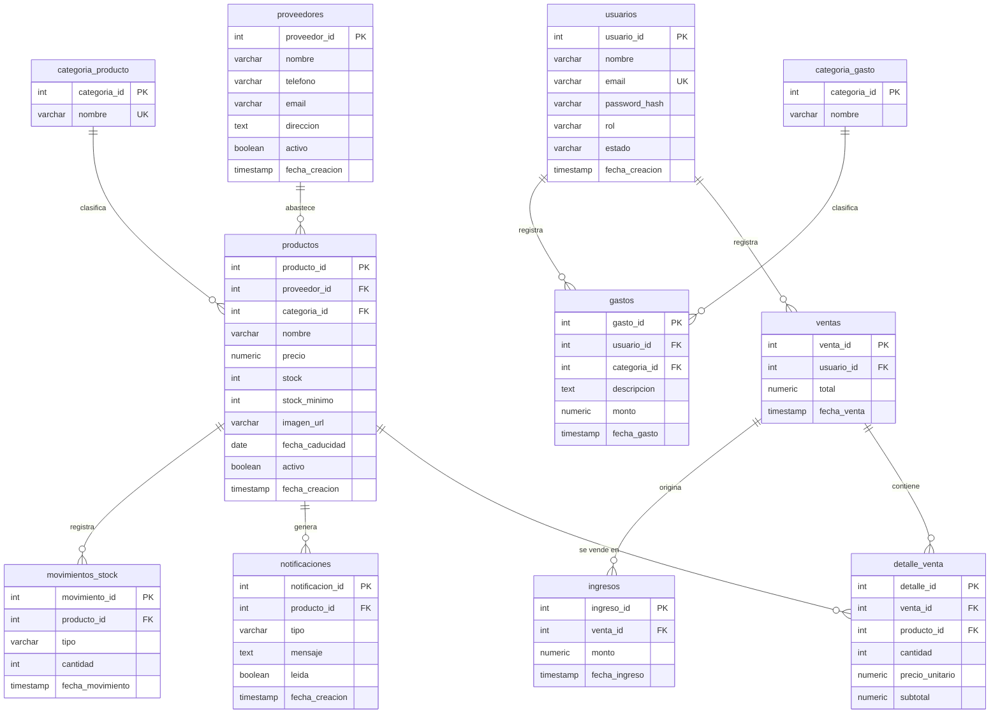

# Esquema de la base de datos

Base de origen: PostgreSQL 17 en Neon (backend Express). Esquema obtenido con `pg_dump --schema-only`.
Destino: proyecto Supabase `mini-pos`.

## Diagrama de relaciones (origen)

## Relaciones (claves foráneas)

| Tabla hija | Columna | Tabla padre | Al borrar el padre |
|---|---|---|---|
| productos | proveedor_id | proveedores | bloquea |
| productos | categoria_id | categoria_producto | bloquea |
| ventas | usuario_id | usuarios | bloquea |
| detalle_venta | venta_id | ventas | borra en cascada |
| detalle_venta | producto_id | productos | bloquea |
| gastos | usuario_id | usuarios | bloquea |
| gastos | categoria_id | categoria_gasto | bloquea |
| notificaciones | producto_id | productos | bloquea |
| ingresos | venta_id | ventas | bloquea |
| movimientos_stock | producto_id | productos | bloquea |

## Cómo se comunican las tablas

- **Venta:** una fila en `ventas` (quién y cuánto) tiene N filas en `detalle_venta` (qué productos, cantidad y precio del momento). Crear o anular una venta también modifica `productos.stock`.
- **Inventario:** cada `productos` pertenece a un proveedor y a una categoría. Al actualizar un producto, el trigger `check_stock_after_update` inserta una fila en `notificaciones` si `stock <= stock_minimo`.
- **Gastos:** `gastos` se clasifica con `categoria_gasto`. Al crear un producto o subir su stock, el backend inserta un gasto automático (sin usuario ni categoría).
- **Dashboard y balance:** se calculan con agregaciones sobre `ventas` y `gastos`; no tienen tablas propias.
- **Sin uso:** `ingresos` y `movimientos_stock` existen pero ningún endpoint las usa y tienen 0 filas.

## Datos al momento del diagnóstico

| Tabla | Filas |
|---|---|
| usuarios | 2 |
| proveedores | 1 |
| categoria_producto | 6 |
| categoria_gasto | 0 |
| productos | 6 |
| ventas | 9 |
| detalle_venta | 16 |
| gastos | 4 |
| notificaciones | 0 |
| ingresos | 0 |
| movimientos_stock | 0 |

## Cambios previstos en Supabase

- `usuarios` se reemplaza por `auth.users` (credenciales) más una tabla `perfiles` (nombre, rol, estado). `ventas.usuario_id` y `gastos.usuario_id` pasan a `uuid` y apuntan a `perfiles`.
- Las fechas pasan de `timestamp` a `timestamptz`.
- Las claves se mantienen como enteros con identidad, conservando los ids actuales, para no romper rutas como `/editarproducto/3`.
- `ingresos` y `movimientos_stock` no se migran (sin uso y sin datos).
- RLS activo en todas las tablas; solo usuarios autenticados y activos acceden.
- La lógica que hoy vive en Express (crear, editar y anular venta, gastos automáticos, dashboard) pasa a funciones de Postgres.
